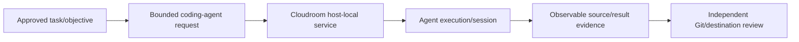

# Fork qualification notes — cloud coding-agent substrate

**Scope:** public source reference, no production deployment acceptance.

Cloudroom core provides a self-hostable Rust service for running coding agents on owner-managed machines. It is a candidate interoperability/delegation substrate rather than an automatic replacement for orchestration, persistent coordination or host runtime ownership.

A browser UI, agent login and host runner each have distinct trust and credential boundaries. Require exact session identity, target repository, worktree separation, task lease/fencing if shared, check/test receipts and clean exit/cancellation. No source commit or agent completion alone proves a live deployment or owner acceptance. Preserve original Apache-2.0 notices and exclude private credentials, internal endpoints, transcripts and host topology.
